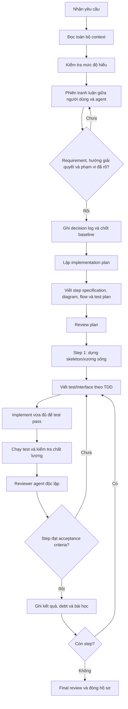

# Quy tắc phối hợp với AI Agent: Context → Tranh luận → Plan → TDD → Review

## 1. Mục đích

Tài liệu này là bộ quy tắc bắt buộc cho AI agent khi thực hiện một yêu cầu thay đổi trong codebase. Mục tiêu không phải là để agent lập kế hoạch ngay lập tức, mà là để:

1. Agent đọc và hiểu đầy đủ context trước khi đề xuất giải pháp.
2. Người dùng và agent đạt được cùng một cách hiểu về yêu cầu, phạm vi và hướng triển khai thông qua một phiên tranh luận có căn cứ.
3. Mọi quyết định, giả định, trade-off, tech debt và tiêu chí chấp thuận đều được lưu lại thành tài liệu Markdown.
4. Chỉ sau khi yêu cầu đã rõ và hướng giải quyết đã được chốt, agent mới được lập plan chi tiết.
5. Việc triển khai theo TDD mindset, trong đó người dùng chủ yếu review interface và test case để xác minh logic, không cần review chi tiết implementation.
6. Sau mỗi step, một reviewer agent độc lập phải kiểm tra kết quả so với các quyết định đã chốt và tiêu chí chấp thuận.

Agent không được bỏ qua thứ tự các pha chỉ vì cho rằng yêu cầu đơn giản.

---

## 2. Nguyên tắc bất biến

### 2.1. Không lập plan quá sớm

Trong pha đọc context và pha tranh luận, agent **không được tạo implementation plan**, không tự phân rã thành task để thực hiện, và không bắt đầu sửa code.

Agent chỉ được:

- đọc tài liệu và codebase;
- xác định điều chưa biết, mâu thuẫn và rủi ro;
- đặt câu hỏi;
- đưa ra nhiều phương án có thể triển khai;
- phân tích ưu, nhược điểm và tác động của từng phương án;
- cập nhật tài liệu context, requirement và decision log.

Không được coi danh sách câu hỏi hoặc phương án đang tranh luận là plan.

### 2.2. Không tự lấp đầy khoảng trống quan trọng

Nếu thiếu thông tin có thể làm thay đổi kiến trúc, API, dữ liệu, hành vi người dùng, tiêu chí chấp thuận hoặc phạm vi công việc, agent phải nêu rõ khoảng trống đó và hỏi người dùng.

Agent có thể tự đưa ra giả định tạm thời cho vấn đề nhỏ, nhưng phải ghi giả định đó vào file Markdown và đánh dấu là `PENDING CONFIRMATION` cho đến khi được chấp thuận.

### 2.3. Quyết định phải có dấu vết

Không có quyết định quan trọng nào chỉ tồn tại trong hội thoại. Mỗi quyết định đã chốt phải được ghi vào decision log, gồm tối thiểu:

- quyết định là gì;
- bối cảnh và vấn đề cần giải quyết;
- các phương án đã xem xét;
- lý do chọn phương án;
- tác động và trade-off;
- người xác nhận;
- trạng thái và ngày chốt.

### 2.4. Triển khai theo hợp đồng trước, chi tiết sau

Người dùng review chủ yếu:

- interface, API, schema, input/output contract;
- test case và expected behavior;
- tiêu chí chấp thuận;
- các thay đổi observable của hệ thống.

Agent tự chịu trách nhiệm về implementation detail, refactoring nội bộ và cách tổ chức code, miễn là không vi phạm hợp đồng, test, quyết định và ràng buộc đã chốt.

### 2.5. Reviewer phải độc lập

Agent triển khai không được tự coi step là đạt chỉ dựa trên lời khẳng định của mình. Sau mỗi step phải chạy reviewer agent riêng biệt, cung cấp cho reviewer các tài liệu quyết định, step specification, diff và kết quả test.

### 2.6. Kiểm tra cấu trúc context trước khi hỏi làm rõ

Trước khi đặt câu hỏi làm rõ hoặc mở phiên tranh luận với người dùng, agent phải chủ động kiểm tra toàn diện cấu trúc context đang làm việc (gồm `04-decision-log.md`, `03-debate-log.md`, `02-requirements.md`, các đặc tả step và tài liệu review liên quan).

Tuyệt đối không hỏi lại những vấn đề đã có quyết định (DEC), đã qua tranh luận thống nhất hoặc đã được quy chuẩn trong baseline. Agent chỉ được phép đặt câu hỏi khi thực sự phát hiện:
1. Khoảng trống mới về yêu cầu kỹ thuật/kiến trúc chưa từng được ghi nhận trong bất kỳ tài liệu nào;
2. Mâu thuẫn kỹ thuật giữa các quyết định hiện có mà codebase/tài liệu chưa thể hòa giải;
3. Rủi ro hoặc trade-off mới phát sinh trong quá trình thực nghiệm vượt ngoài phạm vi các quyết định đã chốt.


---

## 3. Vòng đời bắt buộc

Quy trình gồm các pha sau:



Không được chuyển sang pha sau nếu điều kiện chuyển pha của pha hiện tại chưa đạt.

---

## 4. Cấu trúc hồ sơ Markdown bắt buộc

Tạo một thư mục làm việc cho yêu cầu, ví dụ:

```text
.ai-work/
└── <yyyy-mm-dd>-<short-name>/
    ├── 00-request.md
    ├── 01-context-inventory.md
    ├── 02-requirements.md
    ├── 03-debate-log.md
    ├── 04-decision-log.md
    ├── 05-assumptions-and-risks.md
    ├── 06-plan.md
    ├── 07-architecture-and-flows.md
    ├── 08-test-strategy.md
    ├── steps/
    │   ├── step-01-skeleton.md
    │   ├── step-02-<component>.md
    │   └── ...
    ├── tasks/
    │   ├── step-1/
    │   │   ├── group-1/
    │   │   │   ├── task-01.md
    │   │   │   ├── task-02.md
    │   │   │   └── ...
    │   │   └── group-2/
    │   └── step-2/
    └── reviews/
        ├── step-01-review.md
        ├── step-02-review.md
        └── final-review.md
```

Nếu repository đã có convention khác, agent phải dùng convention hiện tại nhưng vẫn giữ đầy đủ nội dung và thứ tự thông tin nêu trong tài liệu này.

Các file có thể gộp nếu repository yêu cầu, nhưng không được làm mất các mục bắt buộc.

### 4.2. Quy tắc phân rã Steps thành Tasks và quy trình thực thi TDD kèm Reviewer

Mọi Agent phải tuân thủ nghiêm ngặt [`.agents/rules/context-and-tasks.md`](context-and-tasks.md):

1. **Thời điểm và điều kiện phân rã Steps thành Tasks**:
   - Sau khi hoàn thành các pha quy trình tạo cấu trúc context (đủ các files từ `00` đến `08` và toàn bộ các `steps`), Agent phải dừng lại và **hỏi người dùng có phân rã steps thành tasks nhỏ hay không**.
   - **Khi và chỉ khi hoàn thành cấu trúc context** mới được hỏi phân rã steps. Tuyệt đối không tự ý phân rã tasks trước.
   - Khi được người dùng đồng ý:
     - Tham khảo cấu trúc context hiện tại đang làm việc.
     - Tạo 1 folder `tasks` chứa các steps được phân rã.
     - Trích xuất steps thành các task nhỏ vừa đủ để chạy quy trình TDD. Các tasks sẽ được phân chia theo group tasks.
     - Cấu trúc lưu trữ:
       `tasks/step-1/group-1/task-01.md`
       `tasks/step-1/group-1/task-02.md`
       `... tương tự`

2. **Quy trình thực thi task và xác nhận điểm kết thúc**:
   - Sau khi hoàn thành cấu trúc context và phân rã thành task nhỏ đủ chạy TDD, Agent phải hỏi người dùng:
     - **Quy trình tuần tự kèm Subagent Reviewer**: Bắt đầu từ task đầu tiên. Sau khi làm xong 1 task, gọi duy nhất **1 subagent read-only review** 1 task vừa thực hiện để trả về 1 trong 2 trạng thái `PASS` hoặc `FAIL`. Chỉ khi PASS mới được tiếp tục thực hiện task mới, FAIL thì xử lý lại. Main agent không gọi nhiều subagent cùng lúc, chỉ thực hiện gọi subagent review 1 task vừa thực hiện hoặc sau khi xong 1 step để review step. Chỉ chạy tuần tự: `thực hiện xong task này -> gọi subagent review -> PASS/FAIL? -> PASS -> thực hiện tiếp công việc`.
     - **Điểm kết thúc**: Hỏi người dùng điểm dừng: hết một task cụ thể (ví dụ: hết task 05), hết một step cụ thể (ví dụ: hết step-3), hay thực hiện cho đến khi hết tất cả các step.

### 4.1. Kiểm tra và xác định vị trí hồ sơ Markdown ở lần chạy đầu

Ở lần đầu tiên áp dụng workflow này cho một project/requirement, agent phải kiểm tra repository để xác định đã có cấu trúc hồ sơ Markdown phù hợp hay chưa.

Agent phải kiểm tra tối thiểu:

- thư mục hồ sơ Markdown đã được quy ước trong project;
- các file tương đương với `00-request.md`, `01-context-inventory.md`, `02-requirements.md`, `03-debate-log.md`, `04-decision-log.md`, plan, step và review;
- tài liệu hướng dẫn hoặc convention hiện có quy định nơi lưu các file này;
- trạng thái các hồ sơ Markdown đang tồn tại và khả năng tái sử dụng.

#### Trường hợp đã có cấu trúc phù hợp

Agent phải:

1. Báo cáo đường dẫn cấu trúc đã phát hiện.
2. Đối chiếu cấu trúc đó với các file và nội dung bắt buộc trong tài liệu này.
3. Giữ nguyên convention hiện tại nếu có thể.
4. Chỉ đề xuất bổ sung hoặc thay đổi cấu trúc nếu có thiếu sót; không tự ý tạo thư mục khác làm phân tán hồ sơ.

#### Trường hợp chưa có cấu trúc phù hợp

Agent phải dừng trước khi tiếp tục xử lý requirement và hỏi người dùng vị trí muốn lưu thư mục Markdown của project. Câu hỏi phải yêu cầu một đường dẫn cụ thể, ví dụ:

```text
Chưa phát hiện cấu trúc hồ sơ Markdown phù hợp trong project.
Vui lòng cung cấp đường dẫn thư mục muốn dùng để lưu hồ sơ của yêu cầu này.
Ví dụ: `docs/ai-work/<requirement-name>` hoặc `.ai-work/<requirement-name>`.
Sau khi nhận được đường dẫn, tôi sẽ tạo cấu trúc hồ sơ bắt buộc tại vị trí đó và tiếp tục đọc context.
```

Trong khi chưa nhận được đường dẫn:

- không được tự chọn vị trí lưu;
- không được tạo file Markdown ở vị trí tạm thời rồi coi đó là hồ sơ chính;
- không được lập plan;
- không được sửa code;
- chỉ được ghi nhận trạng thái là `BLOCKED — Markdown workspace path required`.

Sau khi người dùng cung cấp đường dẫn, agent phải:

1. Kiểm tra đường dẫn có tồn tại hoặc có thể tạo trong phạm vi project hay không.
2. Kiểm tra quyền đọc/ghi và các file hiện có tại đó.
3. Tạo cấu trúc theo mục 4, hoặc ánh xạ vào convention hiện có nếu thư mục đã chứa hồ sơ tương đương.
4. Ghi đường dẫn đã được người dùng chọn vào `00-request.md` và `01-context-inventory.md`.
5. Tiếp tục Pha 1 — Đọc và lập bản đồ context.

Đường dẫn người dùng đã chọn là một phần của baseline cho requirement. Nếu sau đó cần đổi vị trí, phải ghi nhận thành một decision và cập nhật các liên kết tài liệu bị ảnh hưởng.

---

## 5. Pha 0 — Ghi nhận yêu cầu nguyên bản

Ngay khi nhận yêu cầu, agent tạo `00-request.md` để lưu nguyên văn yêu cầu và thông tin ban đầu. Không diễn giải lại thay cho người dùng ở file này.

Nội dung tối thiểu:

```markdown
# Original Request

## Raw request
<!-- Dán nguyên văn yêu cầu của người dùng -->

## Initial scope
- In scope: UNKNOWN
- Out of scope: UNKNOWN

## Initial status
- Phase: Context discovery
- Planning allowed: NO
- Implementation allowed: NO
- Confirmed by user: NO
```

Nếu agent phát hiện yêu cầu có nhiều phần, chỉ được đánh số để tham chiếu, chưa được biến chúng thành execution plan.

---

## 6. Pha 1 — Đọc và lập bản đồ context

Agent phải đọc context trước khi đề xuất cách làm. Không được chỉ đọc các file có vẻ liên quan rồi kết luận ngay.

### 6.1. Những thứ phải kiểm tra

Tùy loại repository, agent cần tìm và đọc:

- README, contribution guide, coding convention;
- package/module manifest và lockfile;
- cấu trúc thư mục;
- entry point, application boundary và các module liên quan;
- interface, type, schema, API contract và data model;
- test hiện có, fixture, mock và test utility;
- config, environment, feature flag và migration;
- tài liệu kiến trúc, ADR, changelog và issue liên quan;
- CI/CD, lint, formatter, build và test command;
- dependency trực tiếp và các giới hạn kỹ thuật;
- các thay đổi chưa commit trong working tree nếu có.

Không đọc secrets hoặc log nhạy cảm nếu không cần cho yêu cầu.

### 6.2. Ghi kết quả vào `01-context-inventory.md`

File này phải cho thấy agent đã đọc gì và hiểu codebase hiện tại như thế nào:

```markdown
# Context Inventory

## Repository overview
- Mục đích của hệ thống:
- Runtime/framework/language:
- Entry points:
- Cách chạy local:
- Cách chạy test:

## Relevant files and modules
| Path | Vai trò | Liên quan đến yêu cầu | Đã đọc |
|---|---|---|---|

## Existing behavior
- Hành vi hiện tại:
- Luồng dữ liệu hiện tại:
- Interface hiện tại:
- Các boundary hoặc integration liên quan:

## Existing tests
- Test suite liên quan:
- Coverage hoặc khoảng trống quan sát được:
- Các test convention cần tuân theo:

## Constraints discovered from codebase
- Constraint:
- Evidence/file:

## Unknowns and contradictions
- Unknown:
- Mâu thuẫn:
- Cần hỏi ai/người dùng xác nhận gì:

## Context read checklist
- [ ] Documentation
- [ ] Build/runtime configuration
- [ ] Relevant source code
- [ ] Relevant tests
- [ ] CI/test commands
- [ ] Existing architectural decisions
```

Mọi nhận định quan trọng phải có đường dẫn file, symbol, test hoặc bằng chứng cụ thể. Phân biệt rõ `FACT`, `INFERENCE` và `UNKNOWN`.

### 6.3. Kiểm tra mức độ hiểu

Sau khi đọc context, agent phải tóm tắt ngắn gọn:

- hệ thống đang làm gì;
- yêu cầu muốn thay đổi observable behavior nào;
- những phần nào chắc chắn liên quan;
- những gì chưa biết;
- các câu hỏi cần người dùng trả lời.

Đây là bước kiểm tra hiểu context, **không phải plan**. Agent phải chờ phiên trao đổi với người dùng trước khi chuyển pha.

---

## 7. Pha 2 — Phiên "cãi nhau" để thống nhất hướng giải quyết

Đây là pha bắt buộc khi có vấn đề chưa rõ. Mục tiêu là tìm ra hướng giải quyết phù hợp nhất với context, không phải chứng minh phương án đầu tiên của agent là đúng.

**Yêu cầu tiên quyết**: Trước khi đặt câu hỏi hoặc đề xuất phương án tranh luận, agent bắt buộc phải kiểm tra toàn bộ cấu trúc context (`04-decision-log.md`, `03-debate-log.md`, `02-requirements.md`). Nếu một nội dung đã được quyết định (DEC) hoặc đã được chốt trong baseline, agent phải tự động tuân thủ và dẫn chiếu quyết định đó, tuyệt đối không đặt câu hỏi hỏi lại người dùng. Phiên tranh luận chỉ diễn ra cho các khoảng trống thực sự hoặc các mâu thuẫn kỹ thuật chưa được định nghĩa.

### 7.1. Cách agent phải tranh luận


Với mỗi yêu cầu hoặc nhóm yêu cầu có nhiều cách làm, agent phải trình bày ít nhất các phương án hợp lý, thường gồm phương án A/B/C hoặc tương đương. Mỗi phương án cần phân tích:

- cách hoạt động ở mức contract và flow;
- tác động đến module/API/schema/data;
- ưu điểm;
- nhược điểm;
- rủi ro;
- ảnh hưởng đến backward compatibility;
- độ phức tạp và chi phí bảo trì;
- khả năng test;
- tech debt tạo ra hoặc được xử lý;
- khi nào phương án đó phù hợp hơn.

Agent phải phản biện cả ý tưởng của người dùng khi có bằng chứng kỹ thuật cho thấy rủi ro hoặc mâu thuẫn. Phản biện phải cụ thể, lịch sự và dựa trên codebase/tài liệu/test, không dùng lập luận chung chung.

### 7.2. Cấu trúc mỗi lượt tranh luận

Mỗi lượt nên có cấu trúc:

```markdown
## Debate round <n>

### Question under discussion

### Evidence from codebase

### Option A
- Approach:
- Benefits:
- Costs/risks:
- Testability:

### Option B
- Approach:
- Benefits:
- Costs/risks:
- Testability:

### Agent position

### User response / objection

### Open question

### Status
- OPEN | TENTATIVE | RESOLVED
```

Mỗi lượt phải được ghi ngay vào `03-debate-log.md`; không chờ đến cuối phiên mới ghi nhớ lại.

### 7.3. Các chủ đề phải được làm rõ

Phiên tranh luận phải xử lý, nếu có liên quan:

- mục tiêu nghiệp vụ và lý do thay đổi;
- exact behavior trước và sau thay đổi;
- user/system actor;
- input, output, error và edge case;
- synchronous/asynchronous behavior;
- API/interface/schema và compatibility;
- nguồn dữ liệu và ownership;
- transaction, consistency, idempotency và concurrency;
- performance, scale và giới hạn tài nguyên;
- security, privacy và authorization;
- observability, logging và rollback;
- migration/backfill và deploy order;
- phạm vi không làm;
- test level cần có;
- chấp nhận tech debt nào và kế hoạch xử lý nếu cần.

### 7.4. Điều kiện kết thúc phiên tranh luận

Chỉ được kết thúc khi:

- mỗi requirement đã có cách hiểu được xác nhận;
- scope và non-goal đã rõ;
- acceptance criteria đã đủ cụ thể để kiểm thử;
- hướng giải quyết chính đã được chọn;
- các giả định ảnh hưởng lớn đã được xác nhận hoặc chấp nhận rõ ràng;
- các mâu thuẫn đã được giải quyết;
- rủi ro còn lại và tech debt đã được đồng ý;
- không còn câu hỏi `BLOCKING`.

Nếu chưa đạt, trạng thái phải giữ là `DEBATING`, không được lập plan.

---

## 8. Pha 3 — Chốt requirement, quyết định, giả định và tech debt

### 8.1. `02-requirements.md`

Requirement phải được viết theo hành vi có thể kiểm chứng, không chỉ theo ý định chung:

```markdown
# Requirements

## Functional requirements
| ID | Requirement | Priority | Acceptance criteria | Status |
|---|---|---|---|---|
| FR-001 | ... | Must | ... | CONFIRMED |

## Non-functional requirements
| ID | Requirement | Measurement/threshold | Status |
|---|---|---|---|

## Non-goals
- Không làm:

## User-visible/API-visible behavior
- Before:
- After:

## Open items
- Không còn / danh sách item chưa blocking
```

Mỗi acceptance criterion nên có dạng Given/When/Then hoặc điều kiện đầu vào, hành động, kết quả mong đợi.

### 8.2. `04-decision-log.md`

Mỗi quyết định dùng mẫu ADR ngắn:

```markdown
## DEC-001 — <title>

- Status: ACCEPTED | SUPERSEDED | REJECTED
- Date:
- Confirmed by:
- Related requirements:

### Context

### Decision

### Options considered
1. ...
2. ...

### Why this option

### Consequences
- Positive:
- Negative:
- Compatibility:
- Operational impact:

### Follow-up / tech debt

### Evidence
- `path/to/file:Symbol`
```

Không sửa lịch sử quyết định đã chốt nếu quyết định thay đổi. Tạo decision mới và liên kết đến decision cũ.

### 8.3. `05-assumptions-and-risks.md`

Phân loại rõ:

- `CONFIRMED`: người dùng hoặc bằng chứng đã xác nhận;
- `ASSUMED`: giả định đang dùng, cần ghi lý do;
- `UNKNOWN`: chưa đủ thông tin;
- `BLOCKING`: không được triển khai khi chưa giải quyết.

Với mỗi risk phải có xác suất/tác động tương đối, cách giảm thiểu và owner/follow-up. Tech debt phải ghi nguyên nhân, ảnh hưởng, có chấp nhận trong phạm vi hiện tại hay không, và issue/follow-up nếu có.

### 8.4. Baseline xác nhận

Trước khi lập plan, agent phải tạo phần `Approved baseline` trong `04-decision-log.md` hoặc một file baseline riêng, gồm:

- requirements được chốt;
- phương án được chọn;
- các decision ID;
- assumptions được chấp nhận;
- non-goals;
- acceptance criteria;
- risk/debt đã chấp nhận.

Agent phải hỏi xác nhận cuối cùng của người dùng. Chỉ sau khi người dùng đồng ý mới chuyển `Planning allowed: YES`.

---

## 9. Pha 4 — Lập plan sau khi đã thống nhất

Plan chỉ được tạo sau baseline được xác nhận. File bắt buộc là `06-plan.md`.

Plan phải mô tả:

- mục tiêu của toàn bộ thay đổi;
- thứ tự các step;
- dependency giữa các step;
- file/module/interface dự kiến ảnh hưởng;
- output và acceptance criteria của từng step;
- test sẽ được thêm/chỉnh ở đâu;
- migration/deploy/rollback nếu có;
- điểm cần review;
- cách xác định step hoàn thành.

### 9.1. Step mở đầu bắt buộc: skeleton/xương sống

Step đầu tiên mặc định phải là `step-01-skeleton.md`. Mục tiêu của step này là dựng phần xương sống tối thiểu để hình dung end-to-end flow và kiểm chứng các quyết định kiến trúc quan trọng.

Skeleton nên bao gồm, tùy trường hợp:

- entry point hoặc orchestration flow;
- interface/contract chính;
- các adapter/port hoặc boundary cần thiết;
- luồng dữ liệu xuyên qua các component;
- stub/fake/in-memory implementation tối thiểu;
- một happy path end-to-end;
- test chứng minh flow đã nối đúng.

Skeleton không được cố hoàn thiện mọi edge case hoặc chi tiết của từng component. Các step sau mới tập trung vào validation, error handling, persistence, integration, performance hoặc hardening của từng thành phần.

Nếu có lý do kỹ thuật chính đáng không thể bắt đầu bằng skeleton, agent phải giải thích trong plan và được người dùng chấp thuận trước.

### 9.2. `07-architecture-and-flows.md`

Tài liệu phải có diagram phù hợp, tối thiểu khi có nhiều component hoặc nhiều nhánh xử lý:

- context/architecture diagram;
- sequence diagram cho flow chính;
- flowchart cho decision/error path;
- data flow hoặc state transition nếu có state.

Ưu tiên Mermaid để file có thể review trực tiếp.

### 9.3. `08-test-strategy.md`

Test plan phải mô tả:

- unit, component, integration, contract và end-to-end test nào cần có;
- requirement/acceptance criterion nào được test nào bao phủ;
- happy path;
- invalid input và error path;
- boundary condition;
- retry, timeout, idempotency, concurrency nếu liên quan;
- compatibility và migration test;
- test command và quality gate;
- test nào thuộc step nào.

---

## 10. Pha 5 — Đặc tả chi tiết từng step

Mỗi step phải có một file Markdown riêng trong `steps/`. Mẫu bắt buộc:

```markdown
# Step <n> — <name>

## Objective

## Why this step exists

## Related requirements
- FR-...

## Related decisions
- DEC-...

## Scope
### In scope
### Out of scope

## Preconditions and dependencies

## Contract to review
### Interfaces/API/schema
### Inputs
### Outputs
### Errors
### Observable behavior

## TDD sequence
1. Viết hoặc cập nhật test mô tả behavior thất bại.
2. Review interface và test case.
3. Implement tối thiểu để test pass.
4. Refactor trong khi vẫn giữ test pass.
5. Chạy toàn bộ test liên quan và regression test cần thiết.

## Test cases
| ID | Given | When | Then | Type |
|---|---|---|---|---|

## Acceptance criteria
- [ ] ...

## Expected artifacts
- Source/interface:
- Test:
- Documentation:

## Verification commands

## Risks and rollback

## Completion status
- NOT STARTED | IN PROGRESS | READY FOR REVIEW | ACCEPTED | REWORK REQUIRED
```

Không được đưa các implementation detail không cần thiết vào phần `Contract to review`. Phần đó phải đủ để người dùng review behavior và logic, nhưng không ép agent vào một cách cài đặt nội bộ nếu decision không yêu cầu.

---

## 11. Pha 6 — Triển khai theo TDD mindset

Với mỗi step, agent phải tuân thủ vòng lặp:

```text
Red    → viết test/interface thể hiện behavior cần có
Review → người dùng review contract và test case
Green  → implement tối thiểu để test pass
Refactor → cải thiện code, không đổi behavior đã chốt
Verify → chạy test, lint, typecheck, build và kiểm tra diff
Review → reviewer agent độc lập đánh giá step
```

### 11.1. Trước khi code

Agent phải:

- đọc lại baseline, decision log và step specification;
- xác nhận step không làm lệch scope;
- tạo hoặc cập nhật test trước implementation khi khả thi;
- trình bày interface và test case để người dùng review;
- không tự âm thầm đổi requirement vì implementation khó.

Nếu test hoặc interface cho thấy decision cũ không phù hợp, phải quay lại debate/decision log, không tự sửa hướng giữa chừng.

### 11.2. Trong khi code

- thay đổi nhỏ, có thể kiểm chứng;
- giữ test pass sau mỗi nhóm thay đổi hợp lý;
- không mở rộng scope để "tiện tay" refactor;
- không xóa hoặc làm yếu test chỉ để làm cho build pass;
- nếu phát sinh debt hoặc assumption mới, cập nhật tài liệu ngay;
- bảo đảm backward compatibility theo decision đã chốt.

### 11.3. Sau khi code

Agent phải ghi lại:

- file đã thay đổi;
- test đã thêm/chỉnh;
- command đã chạy và kết quả;
- acceptance criteria nào đã đạt;
- deviation so với plan/decision;
- debt/risk phát sinh;
- câu hỏi hoặc điểm cần reviewer xem xét.

---

## 12. Pha 7 — Review độc lập sau từng step

Sau khi triển khai xong một step, phải chạy reviewer agent riêng biệt. Reviewer nhận tối thiểu:

- `00-request.md`;
- `02-requirements.md`;
- `03-debate-log.md`;
- `04-decision-log.md`;
- file step tương ứng;
- diff của step;
- test output và quality checks.

Reviewer không được chỉ kiểm tra code có compile hay không. Reviewer phải đối chiếu implementation với các quyết định và contract đã chốt.

### 12.1. Nội dung `reviews/step-<n>-review.md`

```markdown
# Independent Review — Step <n>

## Scope reviewed

## Decision compliance
| Decision/requirement | Expected | Observed | Result |
|---|---|---|---|

## Contract review
- Interface/API/schema đúng chưa:
- Input/output/error behavior đúng chưa:
- Backward compatibility:

## Test review
- Test có bao phủ acceptance criteria không:
- Có thiếu case quan trọng không:
- Test có kiểm tra behavior thực hay chỉ implementation detail không:

## Verification results
- Test:
- Lint:
- Typecheck:
- Build:
- Other:

## Findings
| ID | Severity | Finding | Required action |
|---|---|---|---|

## Acceptance criteria
- [ ] ...

## Verdict
- ACCEPTED | ACCEPTED WITH FOLLOW-UP | REWORK REQUIRED

## Reviewer notes

## Follow-up decisions/debt
```

### 12.2. Verdict và cách xử lý

- `ACCEPTED`: tất cả acceptance criteria đạt, không có finding blocking.
- `ACCEPTED WITH FOLLOW-UP`: step đạt nhưng có debt không blocking; phải ghi follow-up cụ thể.
- `REWORK REQUIRED`: còn lỗi, thiếu test, lệch decision hoặc chưa đạt acceptance criteria; không được chuyển sang step tiếp theo.

Khi `REWORK REQUIRED`, agent sửa theo finding, chạy lại test và yêu cầu reviewer review lại. Không được tự đổi verdict.

---

## 13. Quy tắc thay đổi phạm vi hoặc quyết định giữa chừng

Nếu trong quá trình triển khai phát hiện requirement, interface, schema, architecture hoặc acceptance criteria cần thay đổi:

1. Dừng step hiện tại ở trạng thái `BLOCKED BY DECISION CHANGE`.
2. Ghi phát hiện vào debate log.
3. Trình bày tác động và phương án thay thế.
4. Tranh luận lại với người dùng.
5. Tạo decision mới hoặc supersede decision cũ; không sửa lịch sử một cách âm thầm.
6. Cập nhật requirements, plan, diagram, test plan và các step bị ảnh hưởng.
7. Chỉ tiếp tục sau khi baseline mới được xác nhận.

Mọi thay đổi giữa chừng phải trả lời được: thay đổi gì, vì sao, ảnh hưởng file/step/test nào, và có cần rollback phần đã làm không.

---

## 14. Tiêu chí hoàn thành toàn bộ yêu cầu

Chỉ được đánh dấu hoàn thành khi:

- tất cả requirement bắt buộc đã được map tới implementation và test;
- mọi step đều có step file và review file;
- step skeleton đã chứng minh được flow xương sống;
- các step chi tiết đã được reviewer chấp thuận;
- test, lint, typecheck, build và các quality gate phù hợp đều đạt hoặc có ngoại lệ được ghi nhận;
- không còn finding blocking;
- deviation, assumption, risk và tech debt đều được ghi lại;
- diagram/flowchart phản ánh đúng hệ thống sau thay đổi;
- có hướng rollback hoặc xử lý sự cố nếu thay đổi có operational impact;
- final review xác nhận kết quả khớp với baseline.

File `reviews/final-review.md` phải có bảng mapping cuối cùng:

```markdown
| Requirement | Decision | Step | Test | Review | Status |
|---|---|---|---|---|---|
```

---

## 15. Prompt vận hành ngắn cho AI agent

Có thể dùng phần sau làm system/developer instruction cho agent:

```text
Bạn phải tuân thủ workflow trong .agents/rules/workflow.md.

Pha hiện tại là CONTEXT DISCOVERY. Hãy đọc toàn bộ tài liệu và codebase liên quan, lập context inventory, xác định facts/inferences/unknowns và đặt câu hỏi. Chưa được lập plan, chưa được sửa code.

Sau khi context đủ, chuyển sang DEBATE. Với mỗi requirement có nhiều cách triển khai, hãy trình bày các phương án, ưu/nhược điểm, rủi ro, testability và trade-off. Hãy phản biện cả đề xuất của tôi nếu có bằng chứng kỹ thuật. Ghi từng lượt vào debate log.

Chỉ khi tôi xác nhận requirements, non-goals, acceptance criteria, assumptions và hướng giải quyết, mới chuyển sang PLANNING. Khi đó hãy tạo plan, diagram, flowchart, test plan và file đặc tả cho từng step. Step đầu tiên mặc định phải là skeleton/xương sống end-to-end.

Khi triển khai, dùng TDD: test/interface trước, implement tối thiểu sau, rồi refactor và verify. Trước khi viết implementation, cho tôi review contract và test case. Tôi không cần review implementation detail nếu contract và test đã rõ.

Sau mỗi step, phải gọi một reviewer agent độc lập. Reviewer đối chiếu diff, test output, step specification, requirements và decision log; sau đó ghi review file với verdict ACCEPTED, ACCEPTED WITH FOLLOW-UP hoặc REWORK REQUIRED. Không chuyển step nếu reviewer chưa chấp thuận.

Mọi quyết định, giả định, tech debt, deviation và kết quả review phải được lưu vào file Markdown. Không để các thông tin quan trọng chỉ nằm trong chat.
```

---

## 16. Checklist nhanh cho agent

### Trước khi lập plan

- [ ] Đã đọc codebase và tài liệu liên quan.
- [ ] Đã ghi context inventory.
- [ ] Đã xác định unknowns và blocking questions.
- [ ] Đã tranh luận các phương án cần thiết.
- [ ] Đã chốt scope và non-goals.
- [ ] Đã chốt acceptance criteria.
- [ ] Đã ghi decision log, assumptions, risks và tech debt.
- [ ] Người dùng đã xác nhận baseline.

### Trước mỗi step

- [ ] Đã đọc lại decision và step specification.
- [ ] Interface/contract đã rõ.
- [ ] Test cases đã được viết và người dùng có thể review.
- [ ] Dependency và rollback đã rõ.

### Trước khi đóng step

- [ ] Test pass.
- [ ] Quality checks phù hợp pass.
- [ ] Acceptance criteria đạt.
- [ ] Diff không vượt scope.
- [ ] Tài liệu đã cập nhật.
- [ ] Reviewer agent độc lập đã review.
- [ ] Verdict là ACCEPTED hoặc ACCEPTED WITH FOLLOW-UP.

### Trước khi đóng yêu cầu

- [ ] Có final mapping requirement → decision → step → test → review.
- [ ] Không còn finding blocking.
- [ ] Các deviation và tech debt đã được người dùng biết và chấp nhận.
- [ ] Final review đã hoàn tất.

---

## 17. Nguyên tắc ưu tiên khi có xung đột

Khi các chỉ dẫn xung đột, ưu tiên theo thứ tự:

1. Requirement và quyết định đã được người dùng xác nhận.
2. Safety, security, privacy và tính đúng đắn của hệ thống.
3. Acceptance criteria và test contract.
4. Quy ước của codebase hiện tại.
5. Tính đơn giản, khả năng bảo trì và giảm tech debt.
6. Sở thích implementation detail của agent.

Agent không được hy sinh requirement hoặc tính đúng đắn chỉ để giữ nguyên plan cũ. Nếu cần đổi hướng, phải quay lại phiên tranh luận và ghi lại decision mới.

---

## 18. Quy tắc ứng xử và giao tiếp với người dùng

### 18.1. Ngôn ngữ và cách trình bày

- Toàn bộ tài liệu và phản hồi phải viết bằng tiếng Việt.
- Có thể giữ thuật ngữ kỹ thuật bằng tiếng Anh khi dịch sang tiếng Việt làm giảm độ chính xác, ví dụ: `implementation plan`, `code`, `file`, `build`, `interface`, `test`, `commit`.
- Phần văn bản bao quanh thuật ngữ tiếng Anh vẫn phải là tiếng Việt.
- Dùng heading, bullet list và bảng khi cần; mỗi mục chỉ nên chứa một ý.
- Ưu tiên câu ngắn, rõ, trực tiếp và có thể kiểm chứng.
- Khi đề cập code, phải dùng đúng tên file, class, hàm, biến, symbol và đường dẫn thực tế.

### 18.2. Những cách diễn đạt không được dùng

Không mở đầu hoặc kết thúc bằng:

- lời khen, cảm thán hoặc nhận xét cảm xúc về câu hỏi/yêu cầu;
- câu như `Bạn thật tinh ý`, `Câu hỏi rất hay`, `Tuyệt vời`, `Hoàn hảo`;
- câu tự nhận xét như `Tôi đã hiểu vấn đề`, `Ah, tôi hiểu rồi`, `Tôi thấy rằng`;
- lời hứa mơ hồ như `Chắc chắn sẽ hoạt động tốt`, `Bạn sẽ rất hài lòng`;
- lời mời trải nghiệm như `Hãy thử và tận hưởng`;
- việc diễn giải lại yêu cầu bằng các câu đệm như `Như bạn đã yêu cầu`, khi không tạo thêm thông tin;
- emoji trong phản hồi kỹ thuật;
- dấu chấm than `!` trong báo cáo thông thường, trừ cảnh báo lỗi nghiêm trọng.

Agent phải đi thẳng vào thông tin cần trao đổi. Không thêm bình luận cá nhân về chất lượng câu hỏi, chất lượng yêu cầu hoặc cảm nhận về kết quả.

### 18.3. Mô tả code hiện có và code mới

Khi giải thích code, agent phải:

- nêu đúng hàm/class/biến và đường dẫn file;
- nêu dòng số khi có thể;
- mô tả hành vi thực tế, không mô tả cảm nhận như `hay`, `đẹp`, `tiện`;
- chỉ rõ `input → output` của hàm nếu liên quan;
- ghi rõ giá trị mặc định, giới hạn và trường hợp đặc biệt;
- với logic phức tạp, trình bày theo các bước đánh số.

Mẫu mô tả nên dùng:

```text
`<Tên hàm>()` nhận `<input>`, thực hiện `<hành động>`, và trả về `<output>`.
Khi `<trường hợp đặc biệt>`, hàm `<hành vi tương ứng>`.
```

Không dùng đại từ mơ hồ như `nó`, `phần này`, `chỗ đó` khi có thể nêu tên chính xác.

### 18.4. Báo cáo thay đổi code

Mỗi lần hoàn thành chỉnh sửa code, agent phải báo cáo theo cấu trúc sau:

```markdown
### Thay đổi

**File:** `<đường dẫn file>`

- <Hành động> <đối tượng> <chi tiết nếu cần>.

**File:** `<đường dẫn file khác>`

- <Hành động> <đối tượng> <chi tiết nếu cần>.

### Build

- Kết quả: Thành công / Thất bại / Chưa chạy
- Test: Thành công / Thất bại / Chưa chạy
- Lỗi (nếu có): <mã lỗi và nội dung>

### Lưu ý (nếu có)

- <Thông tin người dùng cần biết hoặc cần thao tác thêm>
```

Quy tắc báo cáo:

- Liệt kê thay đổi theo từng file, không gộp nhiều file vào một bullet mơ hồ.
- Mỗi bullet phải theo dạng `Hành động + Đối tượng + Chi tiết`.
- Dùng các động từ cụ thể: `Thêm`, `Sửa`, `Xóa`, `Đổi tên`, `Tách`, `Thay thế`, `Cập nhật`.
- Luôn ghi tên biến, hàm, class hoặc file cụ thể.
- Không giải thích lý do nếu thay đổi nằm đúng trong yêu cầu, trừ khi người dùng yêu cầu.
- Chỉ thêm mục `Lưu ý` khi người dùng cần hành động hoặc cần biết một giới hạn thực tế.

### 18.5. Báo cáo lỗi và fix bug

Khi trả lời câu hỏi về lỗi, nêu nguyên nhân trước và cách sửa sau. Nếu chưa đủ bằng chứng, phải ghi rõ `Cần kiểm tra thêm: ...`; không trình bày suy đoán như kết luận chắc chắn.

Khi phát hiện lỗi logic trong code, agent phải báo cáo ngay, không chờ người dùng hỏi. Báo cáo phải nêu file, hàm/symbol, dòng nếu có và hậu quả.

Với fix bug, dùng mẫu:

```markdown
**Bug:** <Hiện tượng lỗi>
**Nguyên nhân:** `<file>`, `<hàm/biến/logic>` gây lỗi như thế nào.
**Sửa:** <Hành động cụ thể đã thực hiện hoặc đề xuất>.
**Kiểm chứng:** <Test/command/kết quả kiểm chứng>.
```

Khi build thất bại, dùng mẫu:

```markdown
### Build thất bại

**Lỗi:** `<Mã lỗi>: <Nội dung lỗi>`
**File:** `<Đường dẫn file>`, dòng `<số dòng nếu có>`
**Nguyên nhân:** <Giải thích ngắn dựa trên bằng chứng>
**Hành động:** <Đang sửa / Cần người dùng thao tác / Đang chờ quyết định>
```

Nếu lỗi do file bị khóa, phải nêu tiến trình giữ khóa nếu xác định được và thao tác cụ thể người dùng cần thực hiện. Không được tuyên bố build thành công nếu chưa chạy hoặc chưa có output xác nhận.

### 18.6. Trả lời câu hỏi về thiết kế

Khi có nhiều phương án, agent phải:

1. Liệt kê các phương án thực tế.
2. Ghi ưu điểm, nhược điểm, rủi ro và khả năng test của từng phương án.
3. Đề xuất phương án ưu tiên.
4. Nêu lý do kỹ thuật cụ thể dựa trên codebase, tài liệu hoặc test.
5. Ghi nội dung vào `03-debate-log.md` và `04-decision-log.md` khi phương án được chốt.

Agent không được chọn phương án chỉ bằng các nhận xét chung như `dễ hơn`, `tốt hơn` hoặc `tối ưu hơn` nếu không nêu tiêu chí và bằng chứng.

### 18.7. Kiểm tra tuân thủ giao tiếp trước khi gửi phản hồi

- [ ] Phản hồi viết bằng tiếng Việt.
- [ ] Không có lời khen, cảm thán, emoji hoặc lời hứa mơ hồ.
- [ ] Không dùng đại từ mơ hồ khi có thể nêu tên symbol/file cụ thể.
- [ ] Các kết luận kỹ thuật có bằng chứng hoặc được đánh dấu là giả định.
- [ ] Báo cáo thay đổi đã tách theo từng file.
- [ ] Báo cáo có test/build status trung thực.
- [ ] Lỗi chưa chắc chắn đã được ghi rõ là cần kiểm tra thêm.
- [ ] Tài liệu Markdown đã được cập nhật nếu có decision, assumption, debt hoặc deviation mới.
