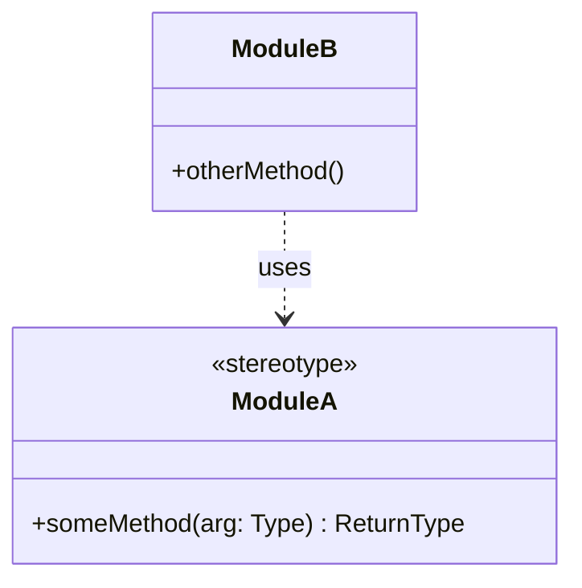
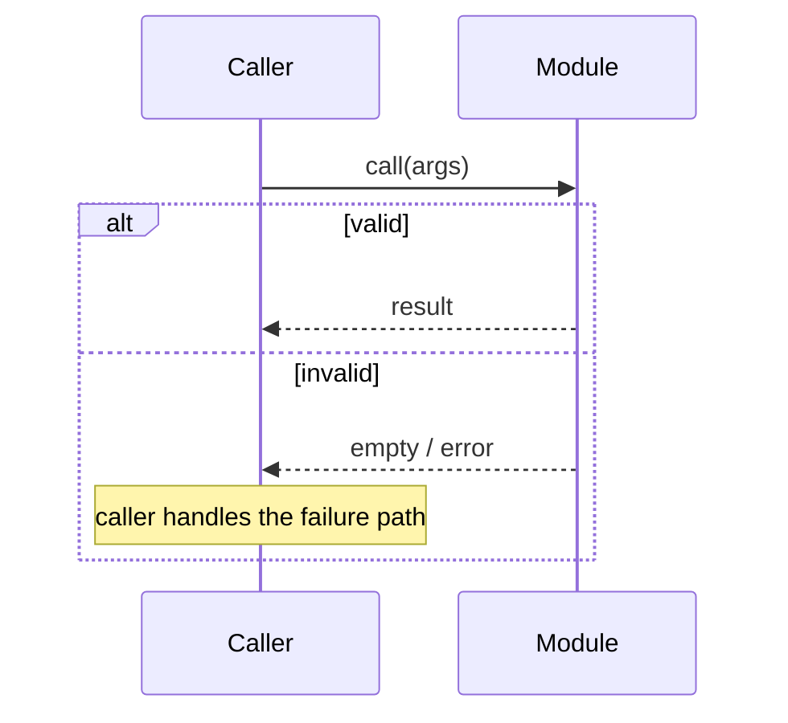

## Problem Statement

The problem that the user is facing, from the user's perspective.

## Solution

The solution to the problem, from the user's perspective.

<!-- ## User Stories

A LONG, numbered list of user stories. Each user story should be in the format of:

1. As an <actor>, I want a <feature>, so that <benefit>

<user-story-example>
1. As a mobile bank customer, I want to see balance on my accounts, so that I can make better informed decisions about my spending
</user-story-example>

This list of user stories should be extremely extensive and cover all aspects of the feature. -->

## Module Breakdown

The deep modules that will be built or modified. For each module give:

- Responsibility - one sentence, what it owns.
- Public interface - the shape of the boundary (function/method signatures, key types), not the implementation.
- New or modified.

Then include a **UML class diagram** (Mermaid `classDiagram`) showing the modules/classes, their key members, and the relationships between them (uses / publishes / reads / inherits / composes). Use `<<stereotype>>` to mark roles (e.g. `<<library>>`, `<<caller>>`, `<<uORB topic>>`).

Do NOT include specific file paths or code snippets. They may end up being outdated very quickly.

## Data & Contracts

The commitments other code depends on and that are expensive to change later. Include only what applies:

- Schema / data model changes
- API contracts (request/response shapes, events, published topics)
- Persisted state
- Error / invalid-input protocols across the boundary

State these unambiguously - a downstream slice must be able to build against them without guessing.

## Control Flow & Interactions

A **UML sequence diagram** (Mermaid `sequenceDiagram`) showing how the modules interact at runtime - the ordering of calls, the returns, and the branches. Prefer the diagram over prose; add a few lines of prose only for what the diagram cannot carry.

Use `alt`/`opt`/`loop` for branches and repetition, and `Note over` for the caller-side steps that are not calls between participants. If a prototype produced a state machine or reducer that encodes a decision more precisely than the diagram can, inline the decision-rich bits here and note they came from a prototype.

## Technical Decisions & Rationale

The non-obvious choices and *why* - "we chose X over Y because Z". This is the section that prevents the decision from being re-litigated later. Cover:

- Architectural decisions and the alternatives rejected
- Technical clarifications from the developer
- Trade-offs consciously accepted

## Testing Decisions

A list of testing decisions that were made. Include:

- A description of what makes a good test (only test external behavior, not implementation details)
- Which modules will be tested, and the type/tier of test each gets
- The concrete cases and the key invariant(s) or property each test must prove, plus the pass bar (tolerances, "no NaN/Inf", edge/degenerate inputs). This is the part that turns "test module X" into something an implementer can act on.
- Prior art for the tests (i.e. similar types of tests in the codebase)

## Plan

A brief, high-level implementation plan describes the main stages, the intended sequencing.

## Out of Scope

A description of the things that are out of scope for this PRD.

## Further Notes

Any further notes about the feature.
